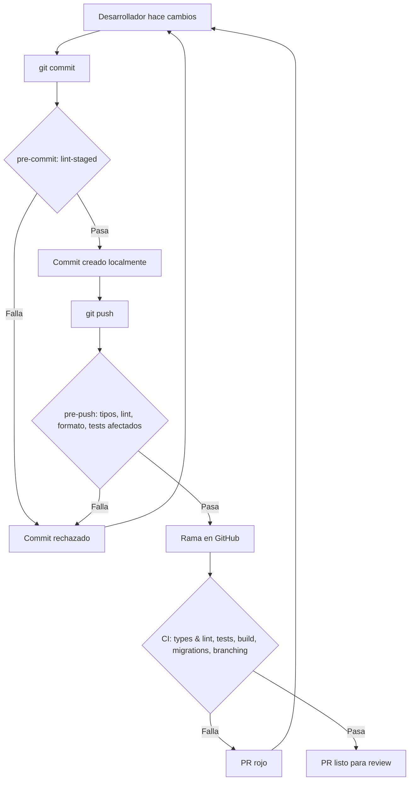

# Hooks de Git y CI

InsureHero valida la calidad del código en **tres capas**, cada una con un alcance distinto: **pre-commit** formatea y lintea lo que tocaste, **pre-push** corre los checks del repo completo más los tests afectados, y el **CI** (GitHub Actions) corre la suite entera y el build antes de aprobar el PR.

El reparto es deliberado: lo rápido y acotado corre en tu máquina; lo lento y total corre en CI, que es el único lugar **compartido** donde se ve. Un test roto en local no lo detecta nadie más; el mismo test roto en CI deja el PR en rojo a la vista de todos.

| Capa | Dónde corre | Qué captura |
|------|-------------|-------------|
| **pre-commit** | Tu máquina, antes del commit | Formato y lint de los archivos staged |
| **pre-push** | Tu máquina, antes del push | Tipos, lint y formato de todo el repo + tests afectados por el diff |
| **CI (GitHub Actions)** | En el PR | Suite completa, build real de las tres apps, checks de migraciones y ramas |

A eso se suma el **build de Vercel** en cada push, que produce el preview y bloquea el deploy si falla.

## Capa 1: pre-commit (lint-staged)

`.husky/pre-commit` ejecuta **`lint-staged`**, así que solo mira los archivos staged:

| Patrón | Qué corre |
|--------|-----------|
| `*.{js,jsx,ts,tsx}` | `prettier --write` y después `eslint --max-warnings=0` |
| `*.{json,css,scss,html,md,yml,yaml}` | `prettier --write --ignore-unknown` |

La configuración (`.lintstagedrc.cjs`) filtra los archivos cubiertos por `ignorePatterns` de ESLint antes de invocarlo: con `--max-warnings=0`, el warning “File ignored because of a matching ignore pattern” tumbaría el commit.

Otros hooks del repo:

- **`commit-msg`** — `commitlint` valida el mensaje contra [Conventional Commits](./conventional-commits.md).
- **`post-merge`** — `yarn && yarn compile`, para que tras un merge los packages compartidos queden al día.

## Capa 2: pre-push

`.husky/pre-push` es el gate pesado en local (esquema abreviado; el hook real imprime un mensaje explícito en cada corte):

```sh
BASE_REF="origin/sandbox"

git fetch --no-tags --quiet origin "+refs/heads/sandbox:refs/remotes/$BASE_REF" || exit 1

yarn check-types && yarn lint && yarn check-format || exit 1

# si el diff toca codigo compartido -> suite completa; si no, solo lo afectado
```

### Qué hace y por qué

1. **Actualiza la base** (`origin/sandbox`) antes de comparar. Sin eso el diff sale contra una ref vieja y se correrían **menos** tests justo cuando la rama está desactualizada. Si el fetch falla (típicamente sin red), el hook **corta con un mensaje**: no compara contra la ref vieja.
2. **`check-types`, `lint` y `check-format`** siguen corriendo sobre **todo el repo**.
3. **Tests afectados** — `yarn test:affected` resuelve, vía `vitest --changed origin/sandbox`, los archivos de test que importan **directamente** un archivo del diff.
4. **Guard de código compartido** — Si el diff toca `packages/*/src/`, `apps/next/src/ui/` o `apps/next/src/utils/`, el hook **escala a `yarn test:ci`** (suite completa) y lo informa por consola.
5. **No corre `yarn build`**. El build es un job del CI.

### Por qué existe el guard

`--changed` tiene alcance de **un solo nivel**: encuentra los tests que importan el archivo del diff, no los de sus dependientes transitivos. En las tres zonas más compartidas eso deja agujeros: `apps/next/src/ui/` son primitivas sin tests propios (un cambio en `button.tsx` no resuelve ningún test pese a tener decenas de importadores), `apps/next/src/utils/` es la carpeta más importada del repo y buena parte de sus archivos no resuelve ningún test, y `--changed` **no cruza los límites de paquete** (`apps/next` consume `@insureHero/*` por su `dist`).

Vitest además escala por su cuenta a la suite completa cuando el diff toca un `package.json` o un `vitest.config.*` (`forceRerunTriggers`), sin pasar por el guard y sin avisar. En los dos casos corre **de más, nunca de menos**.

Qué esperar en tiempo (medido al implementar el reparto): un cambio típico de `apps/next` deja el pre-push en el orden de **3 minutos**, casi todo tipos + lint + formato, con unos segundos de tests. Cuando el guard dispara —aproximadamente 1 de cada 4 pushes— se va a **~7 minutos**, porque corre la suite entera.

### Scripts por workspace

`test:affected` existe solo en los workspaces con tests reales; turbo saltea en silencio a los que no lo tienen.

| Workspace | `test:affected` |
|-----------|-----------------|
| raíz | `turbo run test:affected` |
| `apps/next` | `cross-env CI=true TZ=UTC vitest run --changed origin/sandbox --passWithNoTests` |
| `apps/corporate-benefits-portal` | `vitest run --changed origin/sandbox --passWithNoTests` |
| `packages/iml` | `cross-env CI=true vitest run --changed origin/sandbox --passWithNoTests` |

`--passWithNoTests` cubre el caso habitual: un diff acotado a un workspace deja a los otros sin nada que correr.

**`test:ci` no cambia**: sigue siendo la suite completa en todos los workspaces, y es lo que corre el CI y la escalación del guard.

### Bypass de emergencia (no recomendado)

```bash
git push --no-verify
```

> ⚠️ **Nunca en ramas que vayan a PR.** El CI corre igual y el PR queda rojo; lo único que conseguís es enterarte más tarde.

## Capa 3: CI en GitHub Actions

`.github/workflows/ci.yml` corre sobre **pull requests**. Los jobs de código van **en paralelo**:

| Job | Qué corre |
|-----|-----------|
| **Types & lint** (`validate`) | `yarn compile`, `yarn check-types`, `yarn lint` |
| **Tests** | `yarn test:ci` en la raíz (turbo sobre todos los workspaces) |
| **Build** | `yarn build` — las tres apps Next (`apps/next`, `apps/riskbench`, `apps/corporate-benefits-portal`) más el build de los packages |
| **Migrations** | Checks de proceso sobre `apps/next/supabase/migrations/`: sin timestamps duplicados, timestamps generados por el CLI de Supabase (no a mano) y ninguna migración ya aplicada modificada o borrada |
| **Branching** | Reglas de rama en PRs contra `sandbox`: la rama no puede traer otra rama mergeada adentro, y avisos si arrastra trabajo que ya estaba en `develop`. Ver [Ramas](./ramas.md) |

Detalles que importan del job de **Build**:

- Es la única barrera de build antes de Vercel, y detecta cosas que `tsc --noEmit` no ve: fallos de prerenderizado y generación estática, errores de Server Components que solo aparecen al ejecutarse en build, y módulos `server-only` importados desde un componente `"use client"`.
- Define con valores dummy las variables de entorno **obligatorias** del schema de `apps/next/src/config/env.config.ts`: `middleware.ts` importa ese config y `envVariables.parse(process.env)` corre en scope de módulo, así que sin ellas el build no arranca. No se conecta a nada: solo necesita que el parse pase. Si se agrega una variable obligatoria y no se suma al job, falla con el error de zod — el mismo que daría Vercel.
- `NODE_OPTIONS=--max-old-space-size=6144`: el build de `apps/next` supera el heap por defecto de Node 20 en el runner y muere sin mensaje.

Los tres jobs de código se saltean en eventos de `labeled` / `unlabeled` (esas labels solo las releen `Migrations` y `Branching`), y la cancelación por concurrencia está condicionada al mismo criterio: poner una label no invalida una corrida en vuelo, porque el commit es el mismo.

- `yarn install --frozen-lockfile --ignore-scripts` en todos los jobs: el `prepare` del repo descarga ~400 MB de navegadores de Playwright.
- Sin `yarn compile` en `Tests` ni en `Build`: ambas tasks ya arrastran `^build` por turbo.

## Build de Vercel

Cada push dispara además el build de Vercel, que es el que produce el preview y bloquea el deploy si falla. Turborepo compila primero los packages compartidos (`@insureHero/types`, `utils`, `builders`, …) y después las apps.

### Funciones serverless con timeout extendido

Algunas rutas necesitan más de los ~15 s default. Configurado en `apps/next/vercel.json`:

```json
{
  "functions": {
    "src/app/api/integrations/dispatch/route.ts": { "maxDuration": 60 },
    "src/app/api/integrations/retry/route.ts": { "maxDuration": 60 }
  }
}
```

Estas dos rutas tienen **60 segundos** porque llaman a adapters externos (Phoenix, AMA) que pueden tardar.

## Comandos útiles

Correr a mano lo mismo que el pre-push, antes de pushear:

```bash
yarn check-types
yarn lint
yarn check-format
yarn test:affected     # solo lo que toca el diff contra origin/sandbox
yarn test:ci           # suite completa, como el CI
```

Autoformatear todo el código (evita que `check-format` falle):

```bash
yarn format
```

Regenerar tipos de Supabase tras un cambio de esquema (lee del proyecto DEV remoto: aplicar la migración **antes**):

```bash
yarn gen:db-types
```

Estos tipos alimentan `check-types`; si no se regeneran tras un cambio de esquema, el check falla.

## Diagrama de flujo


